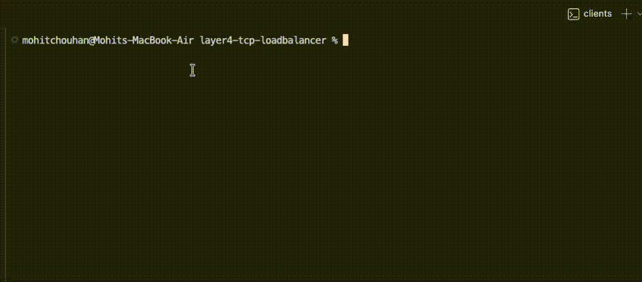
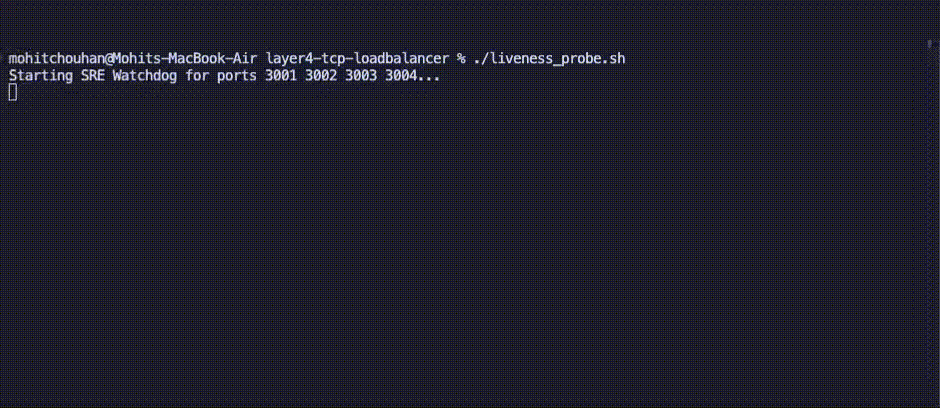

# Custom Layer 4 TCP Load Balancer & Liveness Probe Daemon

A lightweight, high-performance Layer 4 (Transport Layer) load balancer built from scratch in Node.js, paired with an automated Bash-based system health daemon. This project simulates enterprise Site Reliability Engineering (SRE) automated remediation pipelines by distributing TCP traffic and automatically recovering crashed nodes with zero manual intervention.

## 🚀 System Architecture

```text
      [Client Traffic]
             │ (Port 3000)
             ▼
    ┌──────────────────┐
    │  Load Balancer   │ (Node.js) 
    │ (Round-Robin)    │
    └────────┬─────────┘
             │
   ┌─────────┼─────────┬─────────┐ (Pipes TCP streams)
   ▼         ▼         ▼         ▼
[Node 1]  [Node 2]  [Node 3]  [Node 4] (Ports 3001-3004)
   ▲         ▲         ▲         ▲
   │         │         │         │ (Checks every 1s)
   └─────────┴────┬────┴─────────┘
                  │
          ┌───────────────┐
          │ Liveness Probe│ (Bash / Netcat)
          └───────────────┘
```

## 🧠 Core Features

* **Layer 4 TCP Routing:** Direct network packet forwarding and stream piping using Node's native `net` module.
* **Algorithmic Load Balancing:** Implements deterministic Round-Robin routing to evenly distribute concurrent connections across a horizontally scaled 4-node fleet.
* **Auto-Recovery Daemon:** A Bash script that sweeps the entire fleet array every second, instantly detecting process failures and triggering targeted background restarts.
* **Graceful Socket Error Handling:** Safely absorbs `ECONNRESET` events during health checks and packet drops to prevent core routing engine panics.
* **Fleet Automation:** Single-command deployment script (`startFleet.sh`) to orchestrate and spin up the entire multi-node infrastructure concurrently.

## 🛠️ Tech Stack

* **JavaScript / Node.js:** Core routing engine, asynchronous I/O, TCP socket manipulation.
* **Bash:** System orchestration, array-based node monitoring, automated remediation.
* **Linux / Netcat (`nc`) & `lsof`:** Process monitoring, port scanning, and chaos testing.

## 📸 System Demonstration

### 1. Automated Fleet Deployment
The `startFleet.sh` script concurrently spins up the 4 target backend nodes and the central Load Balancer.


### 2. Round-Robin Traffic Distribution
The Load Balancer evenly distributes high-volume incoming TCP connections across the active fleet.


### 3. SRE Automated Remediation
The Liveness Probe daemon continuously monitors the fleet and executes zero-downtime automated restarts if a node goes offline.


## ⚙️ Quick Start

**1. Clone the repository:**
```bash
git clone [https://github.com/yourusername/layer4-tcp-loadbalancer.git](https://github.com/yourusername/layer4-tcp-loadbalancer.git)
cd layer4-tcp-loadbalancer
```

**2. Deploy the Infrastructure:**
Start the 4 backend nodes and the Load Balancer simultaneously.
```bash
chmod +x startFleet.sh
./startFleet.sh
```

**3. Start the Liveness Probe:**
In a **new terminal tab**, launch the SRE daemon to monitor the fleet.
```bash
chmod +x liveness_probe.sh
./liveness_probe.sh
```

**4. Test Traffic Flow:**
In a **third terminal tab**, act as the client sending rapid-fire connections.
```bash
for i in {1..8}; do nc localhost 3000; done
```

## 🌪️ Chaos Engineering Test

To prove the SRE auto-recovery architecture works, simulate a catastrophic multi-node failure:

1. Ensure the infrastructure and Liveness Probe are running.
2. In your client terminal, kill 3 out of 4 nodes instantly:
   ```bash
   kill -9 $(lsof -t -i:3002 -i:3003 -i:3004)
   ```
3. Watch the probe terminal instantly detect the 3 dead nodes, log the failure, and bring them back online within seconds. Run the client test loop again to verify traffic is routing normally.
